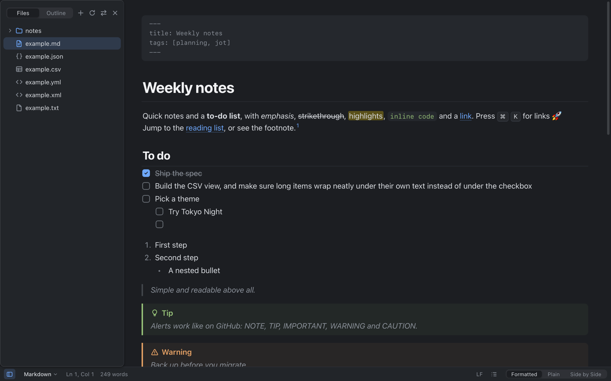

# Jot

**A small, fast text editor for the Mac.** Open a note, a config file, a CSV export or an AI-generated report, and Jot shows it the readable way, with plain text one keystroke away (⌘E).



**[⬇ Download the latest version](https://github.com/jimmiefriberg/jot/releases/latest)** · for Apple silicon Macs (M1 and later) · signed and notarized by Apple

> **A personal project.** Jot is built for my own use and shared as is. You're welcome to use it, but expect bugs and rough edges, and there's no promise of support or fixes. Found a problem? Use **Help → Report a Problem** in the app, or [open an issue](https://github.com/jimmiefriberg/jot/issues).

## What it opens

| File | Shown as |
| --- | --- |
| Markdown (`.md`) | A clean reading view: headings, tables, task lists, code, math, Mermaid diagrams, footnotes. Edit in Plain, or **Side by Side** with a live preview (⌥⌘E). |
| JSON, JSON Lines, YAML, XML | Collapsible trees you can filter and edit in place. |
| CSV, TSV | A spreadsheet-style table: resize, sort, filter and edit cells, even with 100,000 rows. |
| HTML | A preview of the page, for saved AI artifacts, with **Open in Browser**. |
| PDF | A preview with search (⌘F) and zoom. Never edited. |
| Anything else | Plain text, with syntax highlighting where it helps. |

## Highlights

- **Tabs and split view:** ⌘1–⌘9 switch tabs, ⌥⌘\ splits the window, and ⇧⌘T reopens a closed tab.
- **Folders:** a file sidebar, plus Quick Open (⌘P) to jump to any file.
- **Markdown helpers:** paste spreadsheet cells as a table, or a URL over a selection to make a link. Tab moves between table cells.
- **Make it yours:** 21 themes (or your own), fonts, writing modes, and every menu shortcut can be changed in **Settings → Shortcuts**.
- **Updates itself:** Jot checks for new versions when it starts (**Jot → Check for Updates…**).

## Install

1. Download `Jot_x.y.z_aarch64.dmg` from the [latest release](https://github.com/jimmiefriberg/jot/releases/latest).
2. Open it and drag **Jot** into **Applications**.
3. Optional: to open a file type with Jot by default, select such a file in Finder, press ⌘I, choose **Jot** under "Open with", and click **Change All…**.

New versions install from inside the app. Older releases are on the [Releases page](https://github.com/jimmiefriberg/jot/releases).

Everything Jot does, in detail: [SPEC.md](SPEC.md).

---

## For developers

Jot is built with [Tauri 2](https://v2.tauri.app) (Rust), [CodeMirror 6](https://codemirror.net) and React/TypeScript. Why this stack: [docs/research.md](docs/research.md).

### Develop

Requires Bun and Rust.

```sh
bun install
bun run app:dev      # run the app with hot reload
bun run test         # TypeScript unit tests
bun run typecheck
(cd src-tauri && cargo test --lib)   # Rust tests
```

`bun run dev` runs the UI alone in a browser, using sample documents: `http://localhost:1420/?sample=md` (also `json`, `csv`, `yml`, `xml`, `txt`), add `&folder` for the sidebar, and `?settings` for the Settings window. The `examples/` folder has a file of every kind to try in the app.

### Build

```sh
bun run app:build -- --bundles app
cp -R "src-tauri/target/release/bundle/macos/Jot.app" /Applications/
```

That build isn't code-signed, so on first launch you'll need to right-click it and choose **Open**.

### Release

`bun run app:release` builds a signed and notarized `Jot.app`, a DMG and the update files (`Jot.app.tar.gz` and `latest.json`), checks that macOS accepts them, and prints the `gh release create` command that publishes them. It reads the Apple signing settings and the update signing key from `~/.jot-signing.env` (kept out of the repo; see the top of `scripts/release-macos.sh`). Add `-- --target universal-apple-darwin` for a build that also runs on Intel Macs (after `rustup target add x86_64-apple-darwin`).

Installed copies find new versions through `latest.json` on the latest GitHub release, and only install updates signed with the update key.

### Linux (later)

The same code builds on Linux (WebKitGTK). Install the [Tauri Linux prerequisites](https://v2.tauri.app/start/prerequisites/#linux), then run `bun run app:build -- --bundles deb,appimage`.

## Licence

[MIT](LICENSE). Provided as is, without warranty.
