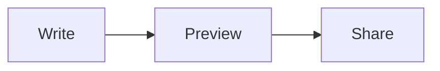

# Markdown tour

Everything Jot renders, in one note. Switch between **Formatted**, **Plain** and **Side by Side** in the status bar.

## Text

Some **bold**, some *italic*, some ***both***, ~~struck~~, `inline code`, ==highlighted==, H<sub>2</sub>O and x<sup>2</sup>.
Press <kbd>⌘</kbd><kbd>E</kbd> to switch views. :tada: :rocket:

A [web link](https://github.com), a [heading link](#tables), a [file link](notes.txt), an autolink https://example.com and a footnote.[^1]

> A quote can span
> several lines.

> [!NOTE]
> GitHub-style alerts render too.

> [!WARNING]
> This one is a warning.

## Lists

- First
- Second
  - Nested
    - Deeper
1. One
2. Two
3. Three

- [x] Finished task
- [ ] Open task (click the box in Formatted view)
- [ ] Another one

---

## Tables

The short GitHub form, no alignment colons:

| Name | Role | City |
|--|--|--|
| Ada | Engineer | London |
| Grace | Admiral | New York |

Aligned columns and a wide table (drag the header edges to resize, double-click an edge to reset):

| Left | Centered | Right | A long description column that should wrap once you make it narrower |
|:-----|:--------:|------:|:-----|
| a | b | 1 | Lorem ipsum dolor sit amet, consectetur adipiscing elit, sed do eiusmod tempor. |
| `code` | **bold** | 22 | Ut enim ad minim veniam, quis nostrud exercitation ullamco laboris. |
| [link](https://example.com) | *italic* | 333 | Duis aute irure dolor in reprehenderit in voluptate velit esse. |

## Code

```ts
function greet(name: string): string {
  return `Hello, ${name}!`;
}
```

```python
def fib(n):
    return n if n < 2 else fib(n - 1) + fib(n - 2)
```

## Math

Inline math $e^{i\pi} + 1 = 0$ and a block:

$$
\int_0^\infty e^{-x^2}\,dx = \frac{\sqrt{\pi}}{2}
$$

## Diagram



## Image


[^1]: Footnotes jump back and forth with ⌘-click.
