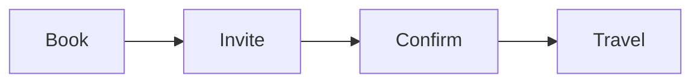

# Team offsite plan

Two days in **Uppsala** for the whole team: planning, a workshop and *plenty* of fika. Budget is ~~SEK 80,000~~ SEK 95,000 after the venue change. Book with <kbd>Ctrl</kbd> <kbd>B</kbd> in the booking tool. H<sub>2</sub>O and coffee provided, x<sup>2</sup> snacks. :tada: :coffee:

See the [venue site](https://example.com), the [schedule](#schedule), the [attendee list](people.csv), https://example.org, and the catering note.[^catering] ==Final headcount due Friday.==

> Good planning is half the work.
> The other half is the snacks.

> [!NOTE]
> The venue has step-free access and a quiet room.

> [!WARNING]
> Trains on the Sunday are replaced by buses.

## Packing list

- Laptop and charger
- Notebook
  - Spare pens
    - A highlighter
- Rain jacket

1. Book the venue
2. Send invitations
3. Collect dietary needs

- [x] Venue booked
- [x] Invitations sent
- [ ] Dietary needs collected
- [ ] Name badges printed

---

## Schedule

| Time | Day 1 | Day 2 |
|--|--|--|
| 09:00 | Arrival and coffee | Workshop |
| 12:00 | Lunch | Lunch |
| 14:00 | Planning session | Wrap-up |

## Budget

| Item | Supplier | Cost (SEK) | Notes |
|:-----|:--------:|-----------:|:------|
| Venue | Slottet Konferens | 42,000 | Includes two meeting rooms, a projector and a terrace that is available until late in the evening if the weather holds. |
| Catering | `Fika & Co` | 31,500 | **Vegetarian** by default; vegan and gluten-free on request. |
| Travel | [SJ](https://example.com) | 21,500 | *Group ticket*, second class, booked as one reservation for everyone. |

## Room booking script

```ts
function hasCapacity(room: { seats: number }, attendees: number): boolean {
  return room.seats >= attendees;
}
```

```python
def cost_per_person(total, people):
    return round(total / people, 2)
```

## Numbers

Cost per person is $\frac{95000}{24} \approx 3958$ SEK, and the room fits

$$
\text{seats} = 6 \times 4 = 24
$$

## Plan



## Logo


[^catering]: Catering confirms the menu one week before.
